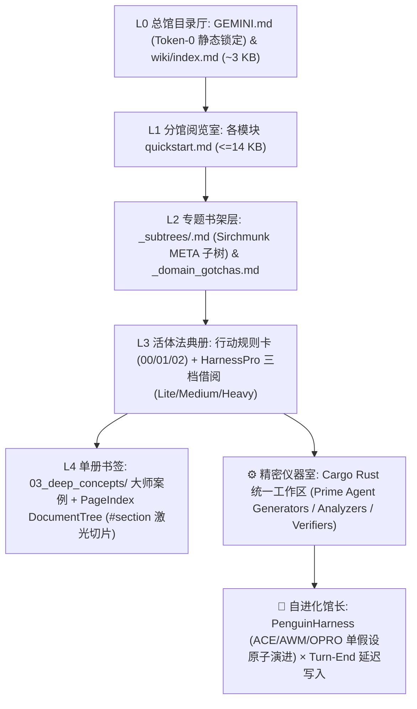

# 📚 AgentStacks（书栈）：自进化个人 Agent 图书馆框架

<p align="center">
  <strong>简体中文</strong> | <a href="README_EN.md">English</a>
</p>

> **给你的 Coding 与多模态创作 Agent 建一座「零上下文爆炸、五级分形书架、帕累托按需借阅、KV 前缀缓存保活、自带可执行脚本」的私人藏书楼（Personal Agent Library）。**
>
> **为什么叫 `AgentStacks`（书栈）？**
> 在图书馆学中，**Stacks** 指层层分级、按索书号井然排列的**「藏书架层」**；在软件工程中，**Stack** 指**「技术栈与调用栈」**。**书栈（`AgentStacks`）** 将你喂给 Agent 的每一本一手原典教材（PDF/EPUB）与课程，转化为层层索引的分形书架（`L0–L4`）与可执行 Rust 校验工具栈——让 Agent 真正拥有一座越读书越博学、却永不撑爆上下文窗口的私人图书馆。
>
> 深度融合 **Karpathy LLM Wiki**、**ModelScope Sirchmunk (`arXiv:2608.16185`)**、**清华唐杰团队 HarnessPro (`arXiv:2610.26770`)**、**DeepSeek `dsh-superagent-prototype`**、**闭卷加噪重建训练 (`Skill Training, arXiv:2607.27557`)**、**Prime Agent (`PrimeIntellect-ai/prime-agent` & `verifiers`)**、**PenguinHarness (`ACE + AWM + OPRO + Gotcha Harvester`)** 与 **LangChain OpenWiki (`OKF v0.2`)**。

---

## 🏛️ 「书栈 (`AgentStacks`)」的个人图书馆空间映射

| 图书馆空间隐喻 | 对应 AgentStacks 架构层级 | 上下文开销 | 核心职责 |
| :--- | :--- | :--- | :--- |
| **📖 原典恒温藏书室**<br>*(Primary Source Vault)* | `raw/<tier>/<domain>/`<br>+ `<book>.receipt.json` | `0 KB`<br>*(按需翻阅)* | 永久珍藏一手 PDF/EPUB 原书（Git 仅追踪 `1 KB` 的 `.receipt.json` 数字藏书票 SHA-256 印章，零仓库膨胀）。 |
| **🗺️ L0 总馆目录厅**<br>*(Main Catalog Hall)* | [`GEMINI.md`](GEMINI.md) & [`wiki/index.md`](wiki/index.md) | `~3 KB` | 常驻馆长总目（静态结构锁定，100% 保护 Token-0 KV 前缀缓存），一眼看清整座书栈有哪些分馆与专题书架。 |
| **🚪 L1 分馆阅览室**<br>*(Reading Rooms)* | `wiki/<tier>/<domain>/quickstart.md` | `≤ 4.5–14 KB` | 三大独立分馆：**底层科学馆 (`foundations`)**、**工具手艺馆 (`tools_craft`)**、**复合管线馆 (`workflows`)**。 |
| **🗄️ L2 专题书架层**<br>*(Subject Stacks)* | `_subtrees/<slug>.md`<br>& `_domain_gotchas.md` | `~2.5 KB` | 基于 `Sirchmunk` 弱语义边自动聚类的专题书架索书表 + 本馆高频排错备忘录。 |
| **📜 L3 活体法典与三档借阅**<br>*(Action Folios & Lending Modes)* | `00_core / 01_craft / 02_style`<br>`--mode {lite,medium,heavy}` | `≤ 6 / 18 / 40 KB` | 经闭卷默写提炼的定量规则册，支持 `HarnessPro` 帕累托三档借阅（摘要卡 `lite` / 平衡拐点 `medium` / 全架联读 `heavy`）。 |
| **🔖 L4 单册书签与仪器室**<br>*(Section Bookmarks & Lab)* | `03_deep_concepts/#section`<br>+ `wiki/**/scripts/*.rs` | `~2–5 KB` | `PageIndex` 章节级 `#section` 激光翻页 + 统一 Cargo Rust 工作区的可执行生成器、分析器与校验器。 |

---

## 🎛️ 极简三大书栈命令（Minimalist 3-Command Interface）

为了杜绝复杂的 CLI 命令心智负担，并保护日常对话的 **KV 前缀缓存（Prompt Cache）**，`AgentStacks` 对用户只暴露**三个直观的个人图书馆技能命令**：

| 命令 | 图书馆角色 | 触发策略与前缀缓存保护 | 核心工作流 |
| :--- | :--- | :--- | :--- |
| **`/study`**<br>*(📖 读书入馆)* | **采编与闭卷内化** | **手动锁 (`disable-model-invocation: true`)**<br>仅在用户显式输入 `/study` 时激活，日常任务零上下文占用 | 全书目录扫描 $\rightarrow$ 提取大师原稿 $\rightarrow$ `Corrupt` 加噪题干 $\rightarrow$ `Closed-Book Forward` 闭卷默写 $\rightarrow$ `Loss` 算残差 $\rightarrow$ 提炼定量规则卡与 Rust 校验器 |
| **`/stacks`**<br>*(🔍 查书用栈)* | **开卷借阅与实战沉淀** | **显式调用 `/stacks` + 常驻轻量护栏**<br>合并原检索与 `wiki-refine`，所有写盘统一推迟至回合末尾（Turn-End） | `L0 -> L1 -> L2 Subtree` 跨层双路由 $\rightarrow$ `HarnessPro` 帕累托三档借阅（`lite/medium/heavy`） $\rightarrow$ `verify-suite` 校验 $\rightarrow$ 回合末尾自动归档踩坑与 ACE 计数 |
| **`/organize`**<br>*(🧹 全馆重整)* | **馆藏去重与重构** | **手动锁 (`disable-model-invocation: true`)**<br>仅在用户显式输入 `/organize` 时激活，替代原 `wiki-lint` | `trace-diagnose` 膨胀卡片审计 $\rightarrow$ `inspect-sources` 回溯 `raw/` 一手原书 $\rightarrow$ `D-Merge` 合并碎片卡 $\rightarrow$ L2 子树重聚类与断言对账 |

---

## 🔌 全平台 Agent 原生兼容矩阵（Universal Multi-Agent Harness Support）

`AgentStacks` 的核心检索引擎与学习编译器基于标准 **Python 3 + Rust (`Cargo`)** 构建，**100% 跨模型、跨 IDE 通用**。仓库内置了四大主流 Agent 工具的原生规则入口与斜杠命令适配器，并且 [`wiki_finalize.py`](.agents/skills/study/scripts/wiki_finalize.py) 会自动保持四端 `L0` 路由表字节级同步（同样享受 `write_text_if_changed` 前缀缓存保活保护）：

| Agent 终端 / IDE | L0 常驻总馆目录（自动同步） | 三大命令（`/study` · `/stacks` · `/organize`）原生适配路径 | 使用方式 |
| :--- | :--- | :--- | :--- |
| **Anthropic Claude Code** (`claude`) | [`CLAUDE.md`](CLAUDE.md) | [`.claude/commands/{study,stacks,organize}.md`](.claude/commands/) + [`.agents/skills/`](.agents/skills/) | 在 Claude Code 中直接输入 `/study <路径>`、`/stacks <任务>`、`/organize` |
| **OpenAI Codex CLI** (`codex`) | [`AGENTS.md`](AGENTS.md) | [`.agents/skills/{study,stacks,organize}/SKILL.md`](.agents/skills/) | 原生识别 `AGENTS.md` 与 `.agents/skills/`，直接输入 `/study`、`/stacks`、`/organize` |
| **Cursor IDE** (`Cursor Agent`) | [`.cursor/rules/agentstacks.mdc`](.cursor/rules/agentstacks.mdc)<br>+ [`AGENTS.md`](AGENTS.md) | [`.cursor/rules/{study,stacks,organize}.mdc`](.cursor/rules/)<br>*(按需挂载 `alwaysApply: false`)* | 在 Cursor Chat 中输入 `@study` / `/study`、`@stacks` / `/stacks`、`@organize` / `/organize` |
| **Google Gemini CLI / Antigravity** | [`GEMINI.md`](GEMINI.md) | [`.agents/skills/{study,stacks,organize}/SKILL.md`](.agents/skills/) | 直接输入 `/study <路径>`、`/stacks <任务>`、`/organize` |

---

## ✨ 为什么需要「书栈 (`AgentStacks`)」？

传统的 Agent 记忆库、RAG 向量检索或扁平 Markdown 知识库，在持续学习专业教材与视频课程时会迅速撞上四大瓶颈：

1. **上下文爆炸与 KV 前缀缓存雪崩（Context Explosion & Prefix-Cache Invalidation）**：随着规则卡片与跨领域依赖增加，一次性加载全量卡片动辄膨胀至 `100 KB–400 KB+`；更致命的是，如果在 `GEMINI.md`（System Prompt 最前端）写入动态变化的卡片/脚本计数，或在任务中途频繁重算文件时间戳，会导致长会话的 **KV 前缀缓存命中率瞬间归零**。
2. **浅层抄书陷阱（`+Distill` Trap）**：直接让大模型阅读教材并总结笔记，只会产出上百张写满“注意光影对比”、“保持声部平滑”的空洞口号卡——因为**大师教材的正面范例中本就不包含外行错误**，模型在实战时依然会犯原生手癖。
3. **软件操作与底层学科耦合（Tool-vs-Foundation Coupling）**：将具体软件按键/API（如 Blender、Krita、REAPER、引擎操作）与普适底层理论（如解剖透视、色彩光学、声学乐理、数值平衡）混写在一起，导致换一个工具就要重写整套知识。
4. **心算幻觉与子 Agent 传话筒劣化（Mental Arithmetic & Subagent Degradation）**：让大模型靠概率生成去“心算”客观声学/透视/数值公式，或把主干需求经有损缩写传话交给失忆的子 Agent 代写，导致产出质量严重退化。

本仓库提供一套 **100% 纯净、零预置知识、从 0 起步的「个人 Agent 图书馆躯壳」**。你可以将任何领域的 PDF/EPUB 权威教材、论文或视频教程喂给 Agent（`/study`），从零生长出结构化、可校验、永不撑爆上下文的持久专家大脑。

---

## 🏗️ 核心架构（5 级分形书架 × 三层正交矩阵 × 前缀缓存保活引擎）



### 1. 三层正交知识矩阵（3-Tier Orthogonal Matrix）
- **Tier 1 — 底层通用科学/美学公理层（`wiki/foundations/<domain>/`）**
  存放跨工具普适的学科公理（如 `visual_aesthetics` 视觉美学与解剖、`cinematography_staging` 镜头调度、`motion_animation` 运动规律、`music_theory_acoustics` 乐理与声学、`narrative_dramaturgy` 叙事剧作、`ludology_systems` 游戏机制与数值平衡）。**严禁出现任何特定软件的菜单或快捷键**。
- **Tier 2 — 媒介与工具手艺层（`wiki/tools_craft/<tool>/`）**
  存放具体软件与工程 API 的实操配方（如 `aseprite_pixel`、`krita_2d_paint`、`blender_3d_layout`、`ae_compositing`、`daw_music_prod`），通过 `requires_foundations` 与卡片级 `depends_on` 强制联动 Tier 1 底层学科（**严禁只看工具层不看底层学科单脚跳**）。
- **Tier 3 — 端到端复合工作流层（`wiki/workflows/<pipeline>/`）**
  串联多个工具与多个底层学科的工业级跨软件流水线（如 `2d_game_production`、`manga_to_anime_pipeline`）。

### 2. Sirchmunk (`arXiv:2608.16185`) × 唐杰团队 `HarnessPro` (`arXiv:2610.26770`) 帕累托预算引擎
结合 ModelScope **Sirchmunk** 的分级树索引与清华唐杰团队 **HarnessPro** 的性能–成本帕累托前沿优化（Pareto Optimization，**拒绝通过多候选并发消耗大量 Token 换取微弱提升**）：
- **PageIndex 章节大纲树（`wiki/.tree-index.json`）**：[`wiki_finalize.py`](.agents/skills/study/scripts/wiki_finalize.py) 自动将每张卡片的 `H2/H3` 标题解析为分级节点（含 `nodeId`、`#slug`、`summary <= 240 chars`、`lineRange`、`charRange`、`quantRuleCount`）。读取超长 `03_deep_concepts` 案例卡时默认展示 `DocumentTree` 导航图，支持 `wiki_query.py read <id>#<section>` 激光切片精读。
- **`KnowledgeCluster` 契约摘要与 `HarnessPro` 帕累托三档运行模式（`--mode {lite,medium,heavy}`）**：
  - **`Lite` 模式（`--mode lite`, `<= 6 KB`）**：面向常规轻量任务，仅输出目标卡片的 `KnowledgeCluster` 契约摘要（`Patterns + Constraints + Scripts`）+ 最多 3 张 1-Hop 前置契约 + Top 2 避坑配方，节省 **~80%** 上下文开销。
  - **`Medium` / `auto` 模式（`--mode medium`, `<= 18 KB`）**：帕累托平衡拐点（默认），输出目标卡完整正文 + 1-Hop 前置契约摘要（`~350 B/卡`）+ 2-Hop 单行指针 + Top 3 避坑配方。
  - **`Heavy` / `full` 模式（`--mode heavy`, `<= 40 KB`）**：面向复杂跨系统合成任务，输出目标卡完整正文 + 1-Hop 前置卡完整正文 + Top 5 避坑配方 + 绑定 Rust 校验器套件。
- **`KnowledgeEvolver` L2 子学科树（`_subtrees/*.md`）与 DF 剪枝 `CorpusTopicMap`**：基于 `WeakSemanticEdge`（`depends_on`、`shared_script`、`ace_co_occur`）将大模块自动拆分为正交 L2 子树；在 [`wiki/.search-index.json`](wiki/.search-index.json) 中构建自动剪枝高频泛化词（`DF > 35%`）的章节级倒排索引。

### 3. KV 前缀缓存保活引擎（Prefix-Cache Pinning & Idempotent Finalizer）
针对 Agent 调用技能（Skills）时容易触发的 **System Prompt / 文件时间戳突变导致前缀缓存命中率暴跌** 问题，内置四重硬件级防护：
- **Token-0 `GEMINI.md` 静态结构锁定**：`GEMINI.md` 中的路由表剥离一切高频变动的卡片/脚本/ACE 数字，仅保留静态模块与子树路径；日常增删改卡片或记录遥测时 `GEMINI.md` 字节 100% 不变。
- **全库幂等零冗余写盘（`write_text_if_changed` & `write_json_if_changed`）**：修复了传统 Finalizer 每次运行都刷新全部卡片 `verified.at` 与 `.claims` 时间戳的缺陷；当卡片正文未变时，重跑 `wiki_finalize.py` 的磁盘写入文件数为 **`0`**。
- **`_domain_index.md` 静态化**：将高频变动的 `ACE:+H/-M` 计数收敛至 `SCOREBOARD.md` 与 `.search-index.json`，避免每次 `record-trace` 污染领域索引。
- **回合末尾延迟写入铁律（Turn-End Deferred Batching）**：所有技能（`/study`、`/stacks`、`/organize`）严禁在多步工具调用中途穿插执行写库/记账，统一延迟至回合收尾阶段一次性提交。

### 4. DeepSeek `dsh-superagent-prototype` 主从路由、零转述指针直传与注意力守恒
融合 DeepSeek Harness 团队 **`dsh-superagent-prototype`** 的核心工程哲学（见 [`GEMINI.md`](GEMINI.md) 第 8 节）：
- **`000-Philosophy.md` 注意力守恒与默认观察模式（Observe-by-Default）**：*“Act only when asked, or when a written rule allows it. Speak only when a person must act or can use a result.”* 未经请求的旁支发现默认静默记入 [`wiki/.gaps.json`](wiki/.gaps.json)，绝不擅自打断用户主线。
- **`dispatch.md` 零转述源指针直传（Zero-Paraphrase Source-Pointer Law）**：唤醒子 Agent（Worker）时严禁仅靠主 Agent 二次缩写传话，必须直传用户原始需求原文 + 一手源文件路径指针（`raw/...`、`ANCHOR.md`）+ 强制子 Agent 第一步自行调用 `wiki_query.py read` 加载底层卡片。
- **`verify.md` 出箱前确定性硬门禁（Pre-Outbox Gate）**：任何产物合入或交付前，必须通过 `study_runner.py verify-suite` 与 `wiki_linter.py --strict`。

### 5. 闭卷加噪重建训练（`Skill Training, arXiv:2607.27557`）× 全书 100% 穷尽防返工门禁 × `Prime Agent` × `PenguinHarness`
- **全书/全片 100% 穷尽覆盖与跨领域分流硬门禁（`wiki/.source-coverage.json`）**：
  - 彻底杜绝“第一次学习只抽读当前项目关心的两章，换项目时被迫二次返工重读同一本教材/视频”的顽疾！
  - 打开任何教材或教学视频时，第一步必须运行 `study_runner.py register-source` 将**全书目录或全片时间轴 100% 登记入账**（若某章节属于其他学科领域，通过 `target_domain` 跨领域分流沉淀，绝不允许跳过）；每完成一章必须调用 `complete-source-unit` 绑定真实存在的卡片 ID。在所有 `reusable: true` 章节 100% 销账前，`prune-raw` 与结业 `commit --verb study` 将被硬件级拦截！
- **闭卷加噪重建（`/study`）**：提取一手教材大师原稿（`human_reference`）$\rightarrow$ 剥离手艺生成题干（`Corrupt`）$\rightarrow$ 仅凭现有卡片闭卷重建（`Closed-Book Forward`）$\rightarrow$ 并排对比算残差（`Ground-Truth Loss`）$\rightarrow$ 跨案例归并共性（`Reduce`）并执行四类原子更新（`A-Reinforce / B-Correct / C-Create / D-Merge`）。
- **Prime Agent 不可变基座与可执行校验器（`PrimeIntellect-ai/prime-agent` & `verifiers`）**：`INSTRUCTIONS.md` 为只读不可变基座，客观计算与审美红线全部硬化为 `wiki/**/scripts/` 下的 Rust 生成器与校验器，支持 `study_runner.py rollback` 一键回滚。
- **PenguinHarness 单假设递归自进化（`Prism-Shadow/penguin-harness`）**：内置 **Gotcha Harvester**（[`wiki/GOTCHAS_AND_RETRY_SAVERS.md`](wiki/GOTCHAS_AND_RETRY_SAVERS.md)）、**AWM 工作流记忆**（[`wiki/AWM_WORKFLOWS.md`](wiki/AWM_WORKFLOWS.md)）、**ACE 有效率追踪**与 **OPRO 单位体积效用评分**（`study_runner.py trace-diagnose`）。

---

## 🚀 快速开始（从 0 构建你的个人 Agent 书栈）

### 环境要求
- **Python 3.9+**（核心 Wiki 引擎仅依赖 Python 标准库，零外部 pip 依赖即可运行）
- **Rust & Cargo**（`rustup`，用于编译和运行 `wiki/**/scripts/` 下的确定性生成与校验脚本）
- *(可选)* `ffmpeg` / `yt-dlp` / `pdfinfo`（用于多模态音视频切片与 PDF 教材预处理）

### 1. 克隆并校验纯净框架
```bash
git clone https://github.com/ShabbyWhineYear/AgentStacks.git
cd AgentStacks

# 运行确定性终结器：同步全库树形索引、Manifest 与 L0/L1/L2 路由表（幂等零冗余写盘）
python3 .agents/skills/study/scripts/wiki_finalize.py

# 运行严格健康门禁：检查 OKF Frontmatter、跨层依赖、Python 与 Cargo 单元测试
python3 .agents/skills/study/scripts/wiki_linter.py --strict
```

### 2. 查看分级树结构与扩展新学科模块
```bash
# 查看全局 L0 -> L1 -> L2 树形目录
python3 .agents/skills/study/scripts/wiki_query.py tree

# 一键脚手架新增自定义基础学科 (foundations)、工具 (tools_craft) 或管线 (workflows)
python3 .agents/skills/study/scripts/scaffold_domains.py \
  --add foundations shader_math "实时着色器数学与光学 (Shader Math & Optics)" \
  --desc "BRDF 光照模型、SDF 距离场数学与实时程序化噪声公理。"
```

### 3. 日常只需记住三大命令：`/study` · `/stacks` · `/organize`
将你需要学习的 PDF/EPUB 教材或视频放入 `raw/<tier>/<domain>/`，在支持 `GEMINI.md` 与 `.agents/skills/` 的 Agent 环境中直接使用三大命令：

```text
# 1. 📖 读书入馆：全量吸收一本新教材或视频课程
/study 学习 raw/foundations/visual_aesthetics/<你的教材.pdf>

# 2. 🔍 查书用栈：显式调取书栈规则卡与 Rust 校验器完成创作/开发任务（回合末自动沉淀经验）
/stacks 帮我按照书栈中的视觉美学与构图规范设计一套赛博朋克 UI 配色与光影方案

# 3. 🧹 全馆重整：当卡片变多或出现重复时，回溯 raw/ 一手原书合并去重并重整子树
/organize 重新整理 visual_aesthetics 模块的书栈卡片
```

<details>
<summary>🔧 <strong>底层开发者 CLI 速查（由 Agent 在后台自动调用，用户无需手动记忆）</strong></summary>

```bash
# 1. 将长 PDF 教材或长视频切分为可消化的学习单元 (Study Units)
python3 .agents/skills/study/scripts/study_runner.py prepare <教材或视频路径> \
  --tier foundations --domain visual_aesthetics

# 2. 混合检索（Phase 0 子树/历史查询匹配 + Phase 1 章节级 CorpusTopicMap + RRF 融合检索）
python3 .agents/skills/study/scripts/wiki_query.py search "<关键词>"

# 3. HarnessPro × Sirchmunk 帕累托三档受控读取（lite <=6KB | medium <=18KB | heavy <=40KB）
python3 .agents/skills/study/scripts/wiki_query.py read <card_id>[#section] --mode medium

# 4. 读取指定 L2 子学科树路由表
python3 .agents/skills/study/scripts/wiki_query.py read --subtree <domain>/<subtree_slug>

# 5. 运行 HarnessPro × OPRO 轨迹诊断与帕累托前沿审计
python3 .agents/skills/study/scripts/study_runner.py trace-diagnose --domain all

# 6. 记录一次排错防踩坑配方 (Gotcha，于回合末尾执行)
python3 .agents/skills/study/scripts/study_runner.py record-gotcha \
  --id "<slug>" --scope "<domain_or_tool>" \
  --symptom "<报错表象>" --root-cause "<底层根因>" --recipe "<一步到位标准解法>"

# 7. 原子提交（自动运行 Finalizer + Linter + Scoreboard 快照 + Git Commit）
python3 .agents/skills/study/scripts/study_runner.py commit --verb study --domain <domain> --summary "完成第 1 章闭卷重建与校验"
```
</details>

---

## 📜 理论致谢与参考项目矩阵

| 参考项目 / 论文 | 机构 / 作者 | 在本框架中的核心落地机制 |
| :--- | :--- | :--- |
| **Karpathy's LLM Wiki** | Andrej Karpathy | 由 LLM 持续维护、复利演进的纯文本 Markdown 知识库范式 |
| **Sirchmunk** (`arXiv:2608.16185`) | ModelScope 团队 | `PageIndex` 文档章节树、`KnowledgeCluster` 1-Hop 契约摘要、`KnowledgeEvolver` L2 子树、DF 剪枝 `CorpusTopicMap` 与 `LENS` 预算控制 |
| **HarnessPro** (`arXiv:2610.26770`, [`pzs19/HarnessPro`](https://github.com/pzs19/HarnessPro)) | 清华大学唐杰团队 & 智谱 AI | 性能–成本帕累托前沿优化、三档运行模式（`Lite / Medium / Heavy`）、`trace-diagnose` 轨迹诊断与无标签合成测试 |
| **Superagent** ([`deepseek-ai/dsh-superagent-prototype`](https://github.com/deepseek-ai/dsh-superagent-prototype)) | DeepSeek Harness 团队 | `000-Philosophy.md` 注意力守恒与默认观察模式、`dispatch.md` 零转述源指针直传、`verify.md` 出箱前确定性硬门禁 |
| **Skill Training** (`arXiv:2607.27557`) | Skill-Training Authors | `Corrupt -> Closed-Book Forward -> Ground-Truth Loss -> Reduce & Backward` 闭卷加噪重建与容量正则化 |
| **Prime Agent & Verifiers** ([`PrimeIntellect-ai/prime-agent`](https://github.com/PrimeIntellect-ai/prime-agent)) | Prime Intellect | 不可变基座（`INSTRUCTIONS.md`）与补充状态分离、`/refine` 轨迹沉淀、Cargo Rust 可执行校验器套件 |
| **PenguinHarness** ([`Prism-Shadow/penguin-harness`](https://github.com/Prism-Shadow/penguin-harness)) | Prism-Shadow | `ACE` 有效率账本、`AWM` 参数化工作流记忆、`OPRO` (`arXiv:2309.03409`) 单位体积效用评分与单假设原子修订 |
| **OpenWiki (`OKF v0.2`) & Ponytail** | LangChain & Google Research | 确定性 `wiki_finalize.py` 编译器、SHA-256 Grounded Claims 证据锚定与最小新造优先复用阶梯 |

## 📄 开源协议
本项目基于 [MIT License](LICENSE) 开源。
