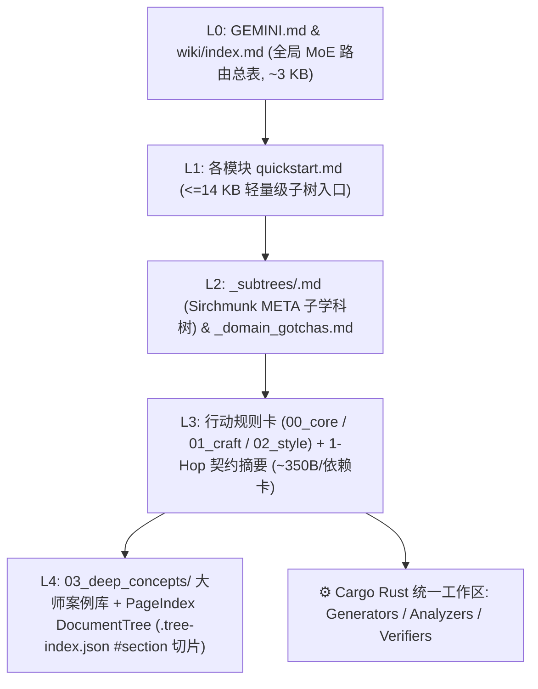

# 🧠 Self-Evolving LLM-Wiki × Sirchmunk 自进化学习框架

<p align="center">
  <strong>简体中文</strong> | <a href="README_EN.md">English</a>
</p>

> **面向 Coding 与多模态创作 Agent 的「零上下文爆炸、三层正交、可执行脚本驱动」持久外部专家大脑框架。**
>
> 深度融合 **Karpathy LLM Wiki**、**ModelScope Sirchmunk (`arXiv:2608.16185`)**、**闭卷加噪重建训练 (`Skill Training, arXiv:2607.27557`)**、**LangChain OpenWiki (`OKF v0.2` & Grounded Claims)**、**Prime Agent（可执行 Rust 校验器）** 与 **PenguinHarness (`ACE + Gotcha Harvester + AWM`)**。

---

## ✨ 为什么需要这套框架？

传统的 Agent 记忆库、RAG 向量检索或扁平 Markdown 知识库，在持续学习专业教材与视频课程时会迅速撞上四大瓶颈：

1. **上下文爆炸（Context Explosion）**：随着规则卡片与跨领域依赖增加，一次性加载全量卡片及其传递依赖动辄膨胀至 `100 KB–400 KB+`，不仅挤爆上下文窗口，还会导致大模型注意力稀释与指令遗忘。
2. **浅层抄书陷阱（`+Distill` Trap）**：直接让大模型阅读教材并总结笔记，只会产出上百张写满“注意光影对比”、“保持声部平滑”的空洞口号卡——因为**大师教材的正面范例中本就不包含外行错误**，模型在实战时依然会犯原生手癖。
3. **软件操作与底层学科耦合（Tool-vs-Foundation Coupling）**：将具体软件按键/API（如 Blender、Krita、REAPER、引擎操作）与普适底层理论（如解剖透视、色彩光学、声学乐理、数值平衡）混写在一起，导致换一个工具就要重写整套知识。
4. **心算幻觉（Mental Arithmetic Hallucinations）**：让大模型靠概率生成去“心算”声学频率、平行五八度、透视消失点或 TTK 战斗数学，而非调用确定性代码脚本计算与验算。

本仓库提供一套 **100% 纯净、零预置知识、从 0 起步的「自进化学习框架躯壳」**。你可以将任何领域的 PDF/EPUB 权威教材、论文或视频教程喂给 Agent（`/study`），从零生长出结构化、可校验、永不撑爆上下文的持久专家大脑。

---

## 🏗️ 核心架构（5 级分形树 × 三层正交矩阵）



### 1. 三层正交知识矩阵（3-Tier Orthogonal Matrix）
- **Tier 1 — 底层通用科学/美学公理层（`wiki/foundations/<domain>/`）**
  存放跨工具普适的学科公理（如 `visual_aesthetics` 视觉美学与解剖、`cinematography_staging` 镜头调度、`motion_animation` 运动规律、`music_theory_acoustics` 乐理与声学、`narrative_dramaturgy` 叙事剧作、`ludology_systems` 游戏机制与数值平衡）。**严禁出现任何特定软件的菜单或快捷键**。
- **Tier 2 — 媒介与工具手艺层（`wiki/tools_craft/<tool>/`）**
  存放具体软件与工程API的实操配方（如 `aseprite_pixel`、`krita_2d_paint`、`blender_3d_layout`、`ae_compositing`、`daw_music_prod`），通过 `requires_foundations` 与卡片级 `depends_on` 强制联动 Tier 1 底层学科（**严禁只看工具层不看底层学科单脚跳**）。
- **Tier 3 — 端到端复合工作流层（`wiki/workflows/<pipeline>/`）**
  串联多个工具与多个底层学科的工业级跨软件流水线（如 `2d_game_production`、`manga_to_anime_pipeline`）。

### 2. Sirchmunk (`arXiv:2608.16185`) 分级树与 LENS 上下文预算引擎
借鉴 ModelScope 团队开源的 **Sirchmunk** 架构，彻底根除长期学习后的上下文膨胀：
- **PageIndex 章节大纲树（`wiki/.tree-index.json`）**：[`wiki_finalize.py`](.agents/skills/study/scripts/wiki_finalize.py) 自动将每张卡片的 `H2/H3` 标题解析为分级节点（含 `nodeId`、`#slug`、`summary <= 240 chars`、`lineRange`、`charRange`、`quantRuleCount`）。读取超长 `03_deep_concepts` 大师案例卡时，默认先展示 `DocumentTree` 章节导航树，支持 `wiki_query.py read <id>#<section>` 激光切片精读。
- **`KnowledgeCluster` 1-Hop 契约摘要（Contract Digest）**：自动从每张卡片提取 `Patterns`（3–5 条核心定量法则）、`Constraints`（适用边界与红线）及 `AbstractionLevel` (`L1–L5`)。调用 `wiki_query.py read <card_id>` 时，主卡片展示完整正文，1-Hop `depends_on` 跨层前置卡自动压缩为 **`~350 B/卡` 的契约摘要**，2-Hop 依赖仅展示单行 ID 指针，硬性锁定单次读取上限（默认 `--budget-kb 18`）。
- **`KnowledgeEvolver` L2 子学科树（`_subtrees/*.md`）**：基于 `WeakSemanticEdge`（`depends_on` 依赖边、`shared_script` 共享脚本边、`ace_co_occur` 共现边），当单模块卡片超过 15 张时自动拆分为正交的 L2 `META` 子树路由表，使 L1 `quickstart.md` 永久保持精简。
- **DF 停用词剪枝 `CorpusTopicMap` 与查询记忆**：在 [`wiki/.search-index.json`](wiki/.search-index.json) 中构建章节级倒排索引并自动剪枝高频泛化词（`DF > 35%`），配合 [`wiki/.ace-telemetry.json`](wiki/.ace-telemetry.json) 中的 FIFO-5 `historicalQueries` 与 `hotness` 热度衰减实现 Phase 0 极速重用。

### 3. 闭卷加噪重建训练闭环（`Skill Training, arXiv:2607.27557`）
仅在用户显式输入 `/study` 时触发，分四阶段将一手教材转化为定量硬规则与 Rust 脚本：
1. **Phase 1 — 一手源归档与正交分流**：将原书 PDF/EPUB 或视频字幕/印相图归档至 `raw/<tier>/<domain>/`，提取 100% 忠实于原著的大师原稿（`human_reference`）存入 `03_deep_concepts/`，并将书中客观公式编写为 Rust 生成器/分析器/校验器脚本。
2. **Phase 2 — 去手艺加噪（`Corrupt`）与严格闭卷重建（`Closed-Book Forward`）**：抹去大师原稿中的专业细节生成重建题干（`corrupted_outline`），仅凭现有 Wiki 卡片闭卷重建（记录 `forward_reads`），主动暴露大模型的原生外行手癖（Amateur Flaws）。
3. **Phase 3 — 一手原稿并排对比与四维残差归因（`Ground-Truth Loss`）**：将重建稿与大师原稿逐项对比并运行 `study_runner.py verify-suite`，精准归因为 `[It Helped]`、`[It Misled / Too Vague]`、`[Routing Failure]` 或 `[Missing Rule / Script Deficit]`。
4. **Phase 4 — 跨案例共性归并（`Reduce`）与四类原子更新（`Backward`）**：执行 `A-Reinforce`、`B-Correct`、`C-Create` 或 `D-Merge`，将定性口号全部硬化为**带数字、带单位、带区间的定量规则**，严控卡片容量（`00_core <= 45 行`，`01/02 <= 60 行`），并反向挂钩至 `tools_craft/` 与 `workflows/`。

### 4. 递归自进化引擎（`PenguinHarness` RSI）
- **排错防踩坑分级账本（Gotcha Harvester）**：单次任务若经历 $\ge 2$ 次工具重试才跑通，调用 `study_runner.py record-gotcha` 自动沉淀至 [`wiki/.gotchas.json`](wiki/.gotchas.json)，生成 L1 总表 [`wiki/GOTCHAS_AND_RETRY_SAVERS.md`](wiki/GOTCHAS_AND_RETRY_SAVERS.md) 与各领域 `_domain_gotchas.md`（读取卡片时自动附带本领域 Top 3 防踩坑配方）。
- **AWM 参数化工作流记忆（Agent Workflow Memory）**：通过 `study_runner.py record-workflow` 将多步跨工具复合操作抽象为带 `{parameter}` 占位符的 `Observation -> Reasoning -> Action` 标准工作流（[`wiki/AWM_WORKFLOWS.md`](wiki/AWM_WORKFLOWS.md)）。
- **ACE 规则实战有效率追踪**：通过 `study_runner.py record-trace` 统计每张卡片与脚本的净有效分（`helpful - harmful`），实时赋能 BM25 检索加权并生成演进记分板 [`wiki/SCOREBOARD.md`](wiki/SCOREBOARD.md)。

---

## 🚀 快速开始（从 0 构建你的专家大脑）

### 环境要求
- **Python 3.9+**（核心 Wiki 引擎仅依赖 Python 标准库，零外部 pip 依赖即可运行）
- **Rust & Cargo**（`rustup`，用于编译和运行 `wiki/**/scripts/` 下的确定性生成与校验脚本）
- *(可选)* `ffmpeg` / `yt-dlp` / `pdfinfo`（用于多模态音视频切片与 PDF 教材预处理）

### 1. 克隆并校验纯净框架
```bash
git clone https://github.com/ShabbyWhineYear/llm-wiki-sirchmunk.git
cd llm-wiki-sirchmunk

# 运行确定性终结器：同步全库树形索引、Manifest 与 L0/L1/L2 路由表
python3 .agents/skills/study/scripts/wiki_finalize.py

# 运行严格健康门禁：检查 OKF Frontmatter、跨层依赖、Python 与 Cargo 单元测试
python3 .agents/skills/study/scripts/wiki_linter.py --strict
```

### 2. 查看分级树结构与扩展新学科模块
```bash
# 查看全局 L0 -> L1 -> L2 树形目录
python3 .agents/skills/study/scripts/wiki_query.py tree

# 一键脚手架新增自定义基础学科 (foundations)、工具 (tools_craft) 或管线 (workflows)
python3 .agents/skills/study/scripts/scaffold_domains.py \
  --add foundations shader_math "实时着色器数学与光学 (Shader Math & Optics)" \
  --desc "BRDF 光照模型、SDF 距离场数学与实时程序化噪声公理。"
```

### 3. 启动第一次学习（`/study`）与日常检索
将你需要学习的 PDF/EPUB 教材或视频放入 `raw/<tier>/<domain>/`，在支持 `GEMINI.md` 与 `.agents/skills/` 的 Agent 环境中输入：
```text
/study 学习 raw/foundations/visual_aesthetics/<你的教材.pdf>
```
常用命令行工具速查：
```bash
# 1. 将长 PDF 教材或长视频切分为可消化的学习单元 (Study Units)
python3 .agents/skills/study/scripts/study_runner.py prepare <教材或视频路径> \
  --tier foundations --domain visual_aesthetics

# 2. 混合检索（Phase 0 子树/历史查询匹配 + Phase 1 章节级 CorpusTopicMap + RRF 融合检索）
python3 .agents/skills/study/scripts/wiki_query.py search "<关键词>"

# 3. LENS 预算受控读取（自动展示正文 + 1-Hop 契约摘要 + Top 3 领域避坑配方）
python3 .agents/skills/study/scripts/wiki_query.py read <card_id>[#section]

# 4. 读取指定 L2 子学科树路由表
python3 .agents/skills/study/scripts/wiki_query.py read --subtree <domain>/<subtree_slug>

# 5. 记录一次排错防踩坑配方 (Gotcha)
python3 .agents/skills/study/scripts/study_runner.py record-gotcha \
  --id "<slug>" --scope "<domain_or_tool>" \
  --symptom "<报错表象>" --root-cause "<底层根因>" --recipe "<一步到位标准解法>"

# 6. 原子提交学习成果（自动运行 Finalizer + Linter + Scoreboard 快照 + Git Commit）
python3 .agents/skills/study/scripts/study_runner.py commit study <domain> "完成第 1 章闭卷重建与校验"
```

---

## 📂 仓库目录结构

```text
.
├── GEMINI.md                     # 全局 Agent 行为宪章与自动维护的 L0 路由总表
├── SCHEMA.md                     # LLM-Wiki v2.0 × Sirchmunk 架构规范与治理契约
├── Cargo.toml                    # 统一 Rust 工作区（自动注册 wiki/**/scripts/**/*.rs）
├── src/lib.rs                    # Rust 共享基础库入口
├── .agents/skills/
│   ├── study/                    # /study 技能（五阶段闭卷重建状态机 + 全套核心引擎脚本）
│   │   ├── SKILL.md
│   │   ├── prompts/              # Phase 1–4 提示词指南（分流、加噪重建、残差诊断、反向传播）
│   │   └── scripts/              # wiki_core, wiki_finalize, wiki_query, wiki_linter, study_runner...
│   ├── wiki-refine/              # /wiki-refine 技能（实战审美纠偏、Gotcha 自动捕获与 AWM 归纳）
│   └── wiki-lint/                # /wiki-lint 技能（一手源回溯重整、D-Merge 合并与健康审计）
├── wiki/                         # 三层正交知识库（初始为 0 张卡片的纯净躯壳）
│   ├── index.md                  # 自动生成的全局 MoE 根路由表
│   ├── GOTCHAS_AND_RETRY_SAVERS.md # L1 排错防踩坑分级路由表
│   ├── AWM_WORKFLOWS.md          # AWM 参数化跨工具工作流记忆库
│   ├── SCOREBOARD.md             # RSI 自进化演进记分板与 ACE 命中统计
│   ├── CURRICULUM_GAPS.md        # 主动求知与教材征集榜
│   ├── foundations/              # Tier 1: 底层通用科学/美学公理层（6 个初始模块骨架）
│   ├── tools_craft/              # Tier 2: 软件与媒介实操层（5 个初始模块骨架）
│   └── workflows/                # Tier 3: 端到端复合生产管线层（2 个初始模块骨架）
└── raw/                          # 第一手原始教材归档区（Git 自动忽略大体积原书/音视频，仅追踪 1KB .receipt.json）
```

---

## 📜 理论致谢与参考架构
- **Karpathy's LLM Wiki**：由 LLM 持续维护、复利演进的纯文本 Markdown 知识库范式。
- **ModelScope Sirchmunk (`arXiv:2608.16185`)**：*Sirchmunk: Learnings that Evolve with Diagnostic Feedback*（`PageIndex` 文档树、`KnowledgeCluster` 抽象契约、`KnowledgeEvolver` 弱语义边子树演化、`CorpusTopicMap` 与 `LENS` 预算控制）。
- **Skill Training (`arXiv:2607.27557`)**：*Skill Training with Corruption and Reconstruction Loop*（`Corrupt -> Closed-Book Forward -> Ground-Truth Loss -> Reduce & Backward`）。
- **LangChain OpenWiki (`OKF v0.2`)**：确定性 `wiki_finalize.py` 编译器、外科手术式 Frontmatter 维护与 SHA-256 Grounded Claims 证据锚定。

## 📄 开源协议
本项目基于 [MIT License](LICENSE) 开源。
