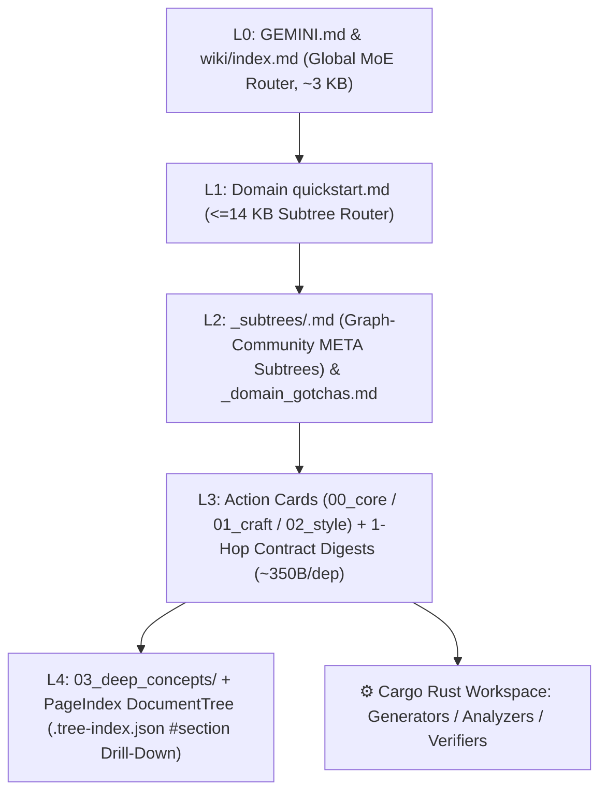

# 🧠 Self-Evolving LLM-Wiki × Sirchmunk Learning Framework

<p align="center">
  <a href="README.md">简体中文</a> | <strong>English</strong>
</p>

> **A Zero-Context-Explosion, 3-Tier Orthogonal, Self-Evolving External Brain for Coding & Creative Agents.**
>
> Fuses **Karpathy's LLM Wiki**, **ModelScope Sirchmunk (`arXiv:2608.16185`)**, **Closed-Book Skill Training (`arXiv:2607.27557`)**, **LangChain OpenWiki (`OKF v0.2` & Grounded Claims)**, **Prime Agent (Executable Rust Verifiers)**, and **PenguinHarness (`ACE + Gotcha Harvester + AWM`)**.

---

## ✨ Why This Framework?

Traditional agent memory systems and flat Markdown wikis fail as knowledge grows:
1. **Context Explosion**: Dumping full cards and transitive dependencies into the prompt quickly exceeds `100 KB–400 KB+`, degrading LLM reasoning and exhausting token budgets.
2. **Shallow Textbook Parroting (`+Distill` Trap)**: Summarizing textbooks directly produces vague, qualitative platitudes instead of fixing the model's actual amateur habits.
3. **Tool-vs-Foundation Coupling**: Mixing software button-clicks (e.g., Blender/Krita/REAPER) with universal domain theory (e.g., anatomy, color science, music theory) creates siloed, non-reusable rules.
4. **Mental Arithmetic Hallucinations**: Letting LLMs mentally guess acoustic frequencies, voice-leading intervals, or perspective projection math instead of executing deterministic Rust verifiers.

This repository provides a **clean, Day-0 empty learning framework shell** ready to ingest textbooks, papers, and video courses from scratch (`/study`) without ever suffering context explosion.

---

## 🏗️ Core Architecture



### 1. 3-Tier Orthogonal Knowledge Matrix
- **Tier 1 — `wiki/foundations/<domain>/`**: Universal scientific, mathematical, and aesthetic axioms (`visual_aesthetics`, `cinematography_staging`, `motion_animation`, `music_theory_acoustics`, `narrative_dramaturgy`, `ludology_systems`). Zero software-specific UI menus.
- **Tier 2 — `wiki/tools_craft/<tool>/`**: Software/medium craft and automation (`aseprite_pixel`, `krita_2d_paint`, `blender_3d_layout`, `ae_compositing`, `daw_music_prod`). Explicitly binds to Tier 1 via `requires_foundations` and card-level `depends_on`.
- **Tier 3 — `wiki/workflows/<pipeline>/`**: End-to-end multi-tool production pipelines (`2d_game_production`, `manga_to_anime_pipeline`).

### 2. Sirchmunk (`arXiv:2608.16185`) Context-Budgeted Tree Routing
- **PageIndex `DocumentTree` (`wiki/.tree-index.json`)**: Every card is automatically indexed into H2/H3 tree nodes (`nodeId`, `#slug`, `summary <= 240 chars`, `lineRange`, `charRange`, `quantRuleCount`). Reading a large `03_deep_concepts` case file automatically presents its `DocumentTree` outline first so the agent can laser-read `wiki_query.py read <id>#<section>`.
- **`KnowledgeCluster` 1-Hop Contract Digests**: Every card exposes extracted `Patterns` (3–5 quantitative rules), `Constraints` (scope exclusions & redlines), and `AbstractionLevel` (`L1–L5`). Running `wiki_query.py read <card_id>` bundles 1-Hop `depends_on` prerequisites as compact `~350 B` Contract Digests (and 2-Hop dependencies as 1-line ID pointers) instead of unbounded transitive full-text dumps.
- **`KnowledgeEvolver` L2 `META` Subtrees (`_subtrees/*.md`)**: Using `WeakSemanticEdge` (`depends_on`, `shared_script`, `ace_co_occur`), domains that grow beyond 15 cards are partitioned into orthogonal L2 subtrees, keeping L1 `quickstart.md` permanently compact.
- **DF-Pruned `CorpusTopicMap` & Query Memory**: Section-level inverted index in `wiki/.search-index.json` with automatic high-document-frequency (`>35%`) stopword pruning, paired with FIFO-5 `historicalQueries` and `hotness` scoring in `wiki/.ace-telemetry.json`.

### 3. Closed-Book Skill Training Loop (`arXiv:2607.27557`)
Triggered manually via `/study`:
1. **Phase 1 — Primary-Source Ingest & Orthogonal Triage**: Archive raw PDF/EPUB/video under `raw/<tier>/<domain>/`, extract verbatim master examples (`human_reference`) into `03_deep_concepts/`, and build Rust calculators/verifiers.
2. **Phase 2 — Corrupt & Closed-Book Forward**: Strip master craft into a bare task skeleton (`corrupted_outline`) and reconstruct the artifact closed-book using only routed Wiki cards (`forward_reads`).
3. **Phase 3 — Side-by-Side Ground-Truth Loss**: Compare `model_reconstruction` against `human_reference` and run `study_runner.py verify-suite` to diagnose over-generation, under-generation, and routing failures.
4. **Phase 4 — Cross-Work Reduce, 4 Atomic Backward Edits & Back-Wiring**: Execute `A-Reinforce`, `B-Correct`, `C-Create`, or `D-Merge` from primary sources, enforcing strict line caps (`00_core <= 45 lines`, `01/02 <= 60 lines`) and back-wiring `depends_on` into `tools_craft/` and `workflows/`.

### 4. Recursive Self-Improvement (`PenguinHarness` RSI)
- **Continual-Learning Gotcha Harvester**: `study_runner.py record-gotcha` records retry-saving recipes into `wiki/.gotchas.json`, generating a compact L1 router (`wiki/GOTCHAS_AND_RETRY_SAVERS.md`) and per-domain `_domain_gotchas.md` tables (auto-attaching Top 3 matching recipes during `wiki_query.py read`).
- **AWM (Agent Workflow Memory)**: `study_runner.py record-workflow` distills multi-step tool trajectories into parameterized `Observation -> Reasoning -> Action` routines in `wiki/AWM_WORKFLOWS.md`.
- **ACE Telemetry & Scoreboard**: `study_runner.py record-trace` tracks net card/script effectiveness (`helpful - harmful`) and updates `wiki/SCOREBOARD.md`.

---

## 🚀 Quickstart (From 0 Knowledge)

### Prerequisites
- **Python 3.9+** (zero external pip dependencies required for core wiki scripts)
- **Rust & Cargo** (`rustup`) for compiling executable generators and verifiers (`Cargo.toml` workspace)
- *(Optional)* `ffmpeg` / `yt-dlp` / `pdfinfo` for multimodal video/audio/PDF chunking

### 1. Verify the Clean Framework
```bash
# Run deterministic finalizer to sync all tree indexes, manifests, and routing tables
python3 .agents/skills/study/scripts/wiki_finalize.py

# Run strict linter + Python & Cargo unit test gate
python3 .agents/skills/study/scripts/wiki_linter.py --strict
```

### 2. Inspect the 3-Tier Hierarchical Tree
```bash
# View global L0 -> L1 -> L2 tree hierarchy
python3 .agents/skills/study/scripts/wiki_query.py tree

# Scaffold a new custom foundation, tool_craft, or workflow domain
python3 .agents/skills/study/scripts/scaffold_domains.py \
  --add foundations shader_math "实时着色器数学与光学 (Shader Math & Optics)" \
  --desc "BRDF 光照模型、SDF 距离场数学与实时程序化噪声公理。"
```

### 3. Ingest Your First Textbook or Course (`/study`)
Place a textbook PDF/EPUB or video under `raw/<tier>/<domain>/` (or pass its path/URL) and instruct your agent:
```text
/study Learning <path/to/textbook.pdf> into foundations/<domain>
```

---

## 📄 License
MIT License. See [LICENSE](LICENSE).
